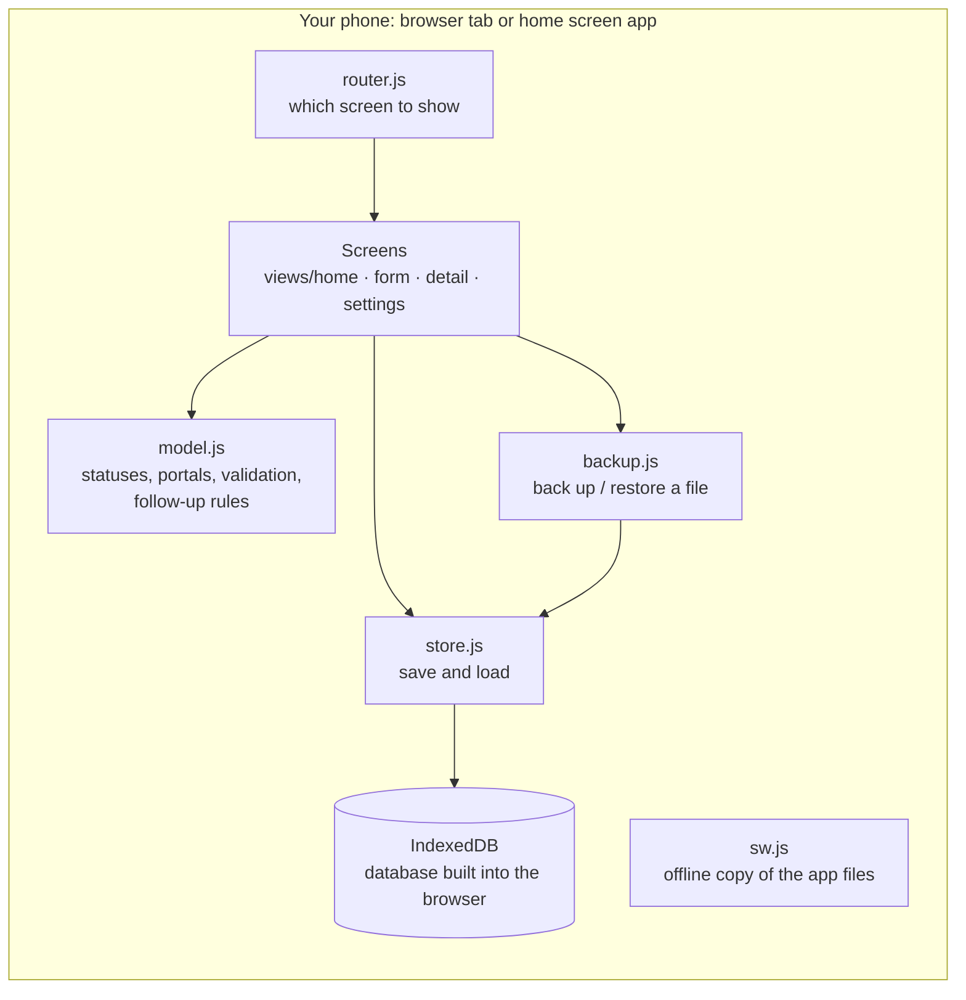

# Foliofy - Application tracker

Live at https://unknown-entity-761.github.io/foliofy/. The app name lives in `app/js/config.js`, `app/index.html` and `app/manifest.webmanifest`.

A phone-first web app for tracking job applications across Workday, SuccessFactors and other portals. It opens in a phone browser, can be added to the home screen like a normal app, and works offline. Everything is saved on the device; there is no account and no server.

## Try it on this computer

Nothing to install. In PowerShell, from this folder:

```powershell
powershell -NoProfile -ExecutionPolicy Bypass -File tools/serve.ps1
```

Then open http://localhost:5173/ in a browser. To see it at phone size in Chrome or Edge, press F12, then the phone icon.

## What's in version 1

- Add, edit and delete applications (delete has an Undo)
- Fields: company, job title, status, portal, login email used, job posting link, date applied, follow-up date, notes
- Home: counts for Applied / Interview / Offer, search, status filters, and follow-ups due at the top
- Details: change status with one tap (each change is kept in History), copy the login email, open the posting, mark a follow-up done or snooze it a week
- Settings: back up to a file, restore from a backup, add to home screen, storage status, delete everything
- Light and dark colors follow the phone's setting
- Works offline once opened

## Version 2 so far

- **Floating tab bar** with labels: Home, Jobs, Add, Activity, Profile. The current tab is highlighted.
- **Home** is just a welcome by first name, the counts (tap one to see those applications) and follow-ups due.
- **Jobs** tab: search, status filters, and sorting by date applied (newest or oldest), company (A to Z or Z to A), job title, status, follow-up date, or recently updated. The sort choice is remembered.
- **Activity** tab: every status change across all applications, in a dropdown for each day with its number of changes.
- **Profile** tab: your profile (name, headline, location, summary, roles you want, experience, education, projects, certifications, skills, contact), a profile strength meter, and your CV and LinkedIn PDF stored on the device.
- **Fill in my profile from my CV / LinkedIn PDF**: reads the file on the device with plain rules, no AI, the way Workday pre-fills its forms. It finds the name, contact details, location, summary, jobs (title, company, dates, points), education, projects, certifications and skills, then opens the edit form with everything found highlighted. Nothing is saved until you tap Save, and it only adds what's missing, so your own edits always win. LinkedIn's "Save to PDF" export has its own reader, which understands its fixed layout, including several roles at one company.
- **OCR for scanned CVs**: if a PDF is a picture of text, the app offers to read it with Tesseract OCR, on the device. The OCR engine (about 5 MB) is only downloaded the first time someone uses it.
- **Settings** (☰ on Profile): Appearance (Match phone, Light, Dark), add to home screen, notification settings (shown, switched on in version 2), **Help improve the app** (opt-in usage data, off by default; `app/js/analytics.js`, nothing is sent until version 2 connects an analytics service), backup/restore/storage/delete, and draft privacy policy, data disclosure, product disclosure statement, terms of use and help. The legal drafts are in `app/js/content/legal.js`; fill in the [square brackets] and get them reviewed before launch.

- **Add to calendar**: an application's details screen offers "Calendar app" (a calendar file with a 9 am reminder) and "Google Calendar" for its follow-up date (`app/js/calendar.js`).
- **Backups** include the CV, LinkedIn PDF and last CV check, and Home reminds you to back up. Phones are asked to add the app to the Home Screen.

Still to come in version 2 (see the PRD): email import, reminders, contacts from email, cover letters and job match. Those need an online service.

## Version 3 so far: the CV check

Open it from **Profile → CV and LinkedIn → Check your CV**. It reads your CV (PDF or Word .docx) on the device, with nothing uploaded, and gives:

- **A score out of 100**, with what to fix, most important first ("Fix first", "Worth fixing", "Nice to have"). Each suggestion quotes the lines from your CV it's about and says how to fix them. Suggestions can be ignored, and the score updates.
- **What's strong**, such as clear headings, results backed by numbers, and dates in order.
- **13 checks**: one-column layout, tables, text boxes and pictures that portals skip; contact details (including details hidden in a Word header); standard headings; length; points with numbers; "Responsible for…" duties; long points and "I"/"my"; date styles and order; common misspellings and repeated words; overused phrases; matching your LinkedIn PDF and profile; the roles you want; and skills from your profile.
- **Check a different file** without saving it, then keep it as your CV if you like.

The rest of the PRD's version 3 needs the AI service: rewrites you can accept into your profile, a full spelling and grammar check, and checking against a job.

The PDF reader is [pdf.js](https://github.com/mozilla/pdf.js) (Mozilla, Apache-2.0), copied into `app/vendor/pdfjs` so it works offline. The OCR engine is [Tesseract.js](https://github.com/naptha/tesseract.js) (Apache-2.0) with the compact English model, in `app/vendor/tesseract`; it isn't in the offline file list, so it's only downloaded when needed. To update either: `npm.cmd install <package>@<version> --save-dev --save-exact`, then `npm.cmd run vendor`, then `npm.cmd test`.

## Version 4 so far: first-time setup

The first time the app opens on a device with nothing saved, it starts at **#/welcome**: upload a CV (read on the device, then the profile form opens with what was found highlighted) or fill it in by hand. Only the first name is required, nothing is saved until Confirm, and "Skip for now" goes to Home. When accounts arrive, this runs straight after signing up. Code: `app/js/views/welcome.js`, plus a `setup` option in `profile-import.js` and `profile-edit.js`.

### Computer layout

On screens 960 pixels wide or more, a side menu replaces the bottom tab bar, and on Jobs the applications list stays on the left with an application's details on the right (`app/js/views/shell.js`, and the "Computer layout" block at the end of `styles.css`). Phones are unchanged. Screens that save data send a `foliofy:data-changed` event (from `store.js`), which keeps the list beside the details up to date.

## Preview label

The app is labelled a **preview** for testers: a "Preview" tag next to the name on Home, and "version 3.0 preview" in Settings. Both open or sit next to **What's coming** (Settings → About), which lists what works now and what's planned, so missing features aren't reported as bugs. The text is in `app/js/content/legal.js` (`coming`).

## Tests

```powershell
npm.cmd test
```

Runs everything in `tests/` with Node's built-in test runner (Node 22 or newer; nothing to install):

- `cv-read`: reading PDFs, Word files and scanned PDFs, and the messages for files that can't be read
- `cv-parse`: filling in the profile from a CV or LinkedIn PDF, and "your edits win" when merging
- `cv-check`: the CV check's score, fixes and strengths on three sample CVs
- `saving-and-backup`: saving, and how a restore merges (Node has no IndexedDB, so this uses the store's in-memory mode)
- `applications`: cleaning input, required fields, status history, follow-ups, sorting
- `offline-files`: every file the app imports exists and is kept for offline use

The sample CVs are in `tests/fixtures` (the HTML they were printed from is in `tests/fixtures/sources`); the Word CV is built in `tests/helpers.mjs`. If you change a CV rule on purpose, update the expected results in the test.

## Releasing a new version

Push to `main`. GitHub then runs the tests, writes the offline file list and cache name into `app/sw.js` (`tools/build-sw.mjs`), and publishes. If a test fails, nothing is published and the live app stays as it was.

The cache name comes from the files' contents, so every change gives a new one. Phones notice it the next time the app opens or comes back on screen, and show **"A new version of Foliofy is ready. Reload"**. To update `sw.js` on this computer too (for example before trying offline mode locally), run `npm.cmd run build-sw`.

## How it's built

Plain HTML, CSS and JavaScript modules. No framework and no build step, so any simple web host can serve the `app/` folder as it is.



| File | Job |
| --- | --- |
| `app/index.html` | The page shell. Links the styles, the app icon and the install manifest |
| `app/js/app.js` | Starts everything: opens storage, registers screens, turns on offline mode |
| `app/js/router.js` | Maps addresses like `#/a/123` to screens; handles Back |
| `app/js/model.js` | What an application is: fields, statuses, portals, validation, follow-up logic |
| `app/js/store.js` | The only code that touches saved data (IndexedDB) |
| `app/js/backup.js` | Back up to and restore from a `.json` file |
| `app/js/install.js` | "Add to home screen" support |
| `app/js/config.js` | App name and version |
| `app/js/analytics.js` | "Help improve the app" consent and the `track()` hook for version 2's analytics; rules for what may be sent |
| `app/js/prefs.js` | Small per-device preferences (sort order, theme, first name) |
| `app/js/profile.js` | Your profile and your CV / LinkedIn files: shape, cleaning, saving, profile strength |
| `app/js/content/legal.js` | Draft text for the privacy, data, product disclosure, terms and help pages |
| `app/js/theme.js` | Light / dark / match-phone |
| `app/js/ui.js` | Shared helpers: safe HTML, icons, dates, toast messages |
| `app/js/views/*.js` | One file per screen: home, applications, activity, profile, profile-edit, form, detail, settings, settings-pages, legal |
| `app/js/views/components.js` | Tab bar, sub-page header, application card and empty state shared by screens |
| `app/js/cv/extract.js` | Reads a CV's text and layout: PDFs with pdf.js, Word .docx files from their XML |
| `app/js/cv/zip.js` | Unzips Word files (a .docx is a zip), using the browser's built-in decompression |
| `app/js/cv/rules.js` | The CV check's 13 rules and the score. No screen code, so they can be tested on their own |
| `app/js/cv/text.js` | Shared CV text rules: dates, contact details, section headings |
| `app/js/cv/parse.js` | Reads a CV or LinkedIn PDF into profile fields, with plain rules (no AI) |
| `app/js/cv/ocr.js` | Reads scanned PDFs with Tesseract OCR, loaded only when needed |
| `app/js/views/cv-check.js` | The CV check screen |
| `app/js/views/shell.js` | Computer layout: the side menu and the applications list beside the details |
| `app/js/views/welcome.js` | First-time setup: upload a CV or fill in the profile by hand |
| `app/js/calendar.js` | "Add to calendar" for follow-up dates: a calendar file or a Google Calendar link |
| `app/js/views/profile-import.js` | "Fill in my profile from my CV": reading, the OCR offer, then the review |
| `app/vendor/pdfjs/` | pdf.js, the PDF reader (copied from npm by `tools/vendor.ps1`) |
| `app/vendor/tesseract/` | Tesseract OCR and its English model (copied from npm by `tools/vendor.ps1`) |
| `package.json` | Scripts for the tests and the offline file list, and the readers npm fetches; the app itself has no build step |
| `tests/` | Automated tests and sample CVs (`npm.cmd test`) |
| `tools/build-sw.mjs` | Writes the offline file list and cache name into `app/sw.js` (`npm.cmd run build-sw`; GitHub runs it before publishing) |
| `app/js/views/fields.js` | Labelled form fields and error messages shared by the forms |
| `app/css/styles.css` | All styles; colors are variables, so dark mode is one block |
| `app/sw.js` | Service worker: keeps the app working with no signal |
| `app/manifest.webmanifest` | Name, icons and colors used when installed |
| `tools/serve.ps1` | Local web server for trying the app on this computer |
| `tools/make-icons.ps1` | Redraws the PNG icons |
| `tools/vendor.ps1` | Copies pdf.js and Tesseract from `node_modules` into `app/vendor` (`npm.cmd run vendor`) |

### Design decisions

- **One door to the data.** Screens never touch IndexedDB directly; they call `store.js`, and every function there returns a Promise. In version 2, `store.js` can sync with an online service and the screens stay the same.
- **Dates as `YYYY-MM-DD` text.** Dates sort and compare as plain text, with no time zone surprises.
- **Safe by default.** Everything typed in is escaped before it's shown, and posting links only open if they are normal `http(s)` addresses.
- **Status history.** Every status change is recorded with a time. Version 2 needs this for email updates and undo.
- **Backups are versioned.** Each backup records `schemaVersion`, so later versions can read old backups.

## Data saved for each application

| Field | Example |
| --- | --- |
| `company` | Acme Corp (required) |
| `title` | Data Analyst (required) |
| `status` | saved, applied, assessment, interview, offer, rejected, ghosted |
| `portal` | Workday |
| `loginEmail` | the email used for that portal |
| `postingUrl` | https://acme.wd5.myworkdayjobs.com/… |
| `appliedOn`, `followUpOn` | 2026-11-21 |
| `notes` | free text |
| `statusHistory` | each status with the time it was set |
| `id`, `createdAt`, `updatedAt` | set automatically |

Passwords are never stored.

## Putting it on your phone

The phone needs a web address to open the app, with `https` (offline mode and home screen install need it). This project publishes to **GitHub Pages**: `.github/workflows/pages.yml` uploads the `app/` folder every time changes are pushed to the `main` branch, and the app appears at `https://<your-username>.github.io/<repository-name>/` a minute or two later.

One-time setup on GitHub: **Settings → Pages → Build and deployment → Source: GitHub Actions**. After that, publishing a change is:

```powershell
git add -A
git commit -m "Describe the change"
git push
```

Each publish shows up in the repository's **Actions** tab, with a red cross if it failed. Then open the address on the phone and add it to the home screen:

- **iPhone:** Safari → Share → Add to Home Screen
- **Android:** Chrome → ⋮ → Install app

Google Play and App Store versions are planned for version 4, together with accounts (see the PRD for why). They'll wrap this same `app/` folder with Capacitor.

## Things to know

- Data lives only on the device it was entered on. Back up regularly from Settings.
- Clearing the browser's site data deletes the applications. On iPhone, the home screen app is less likely to be cleared than a Safari tab.
- The app loads fresh files whenever it's online, so edits show up on the next open. The offline file list in `app/sw.js` is written automatically (see Releasing a new version), so new or renamed files are picked up without editing it.
